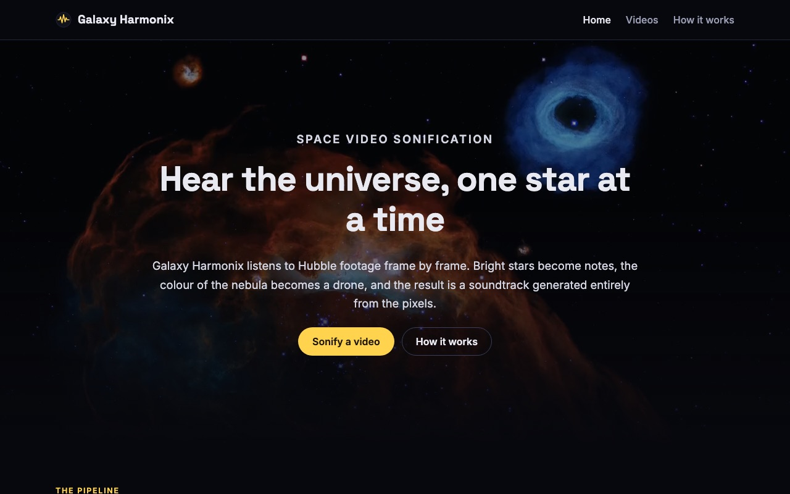
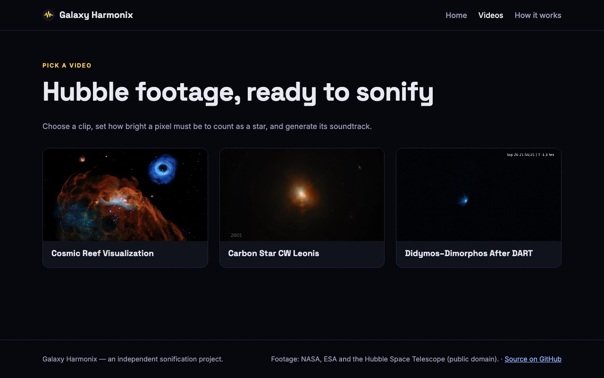
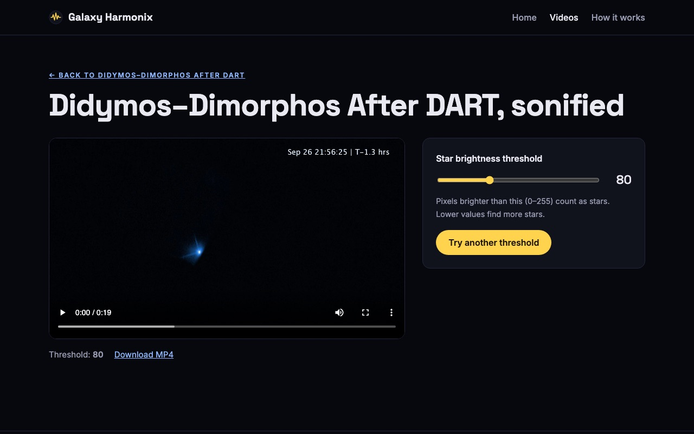
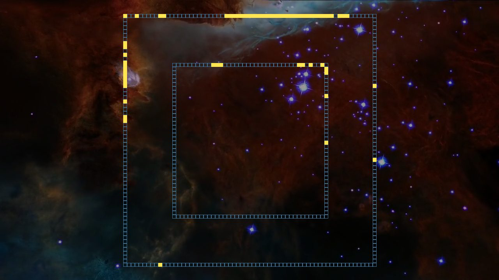

# Galaxy Harmonix

**Turn space videos into sound.** Galaxy Harmonix reads Hubble footage frame by frame and generates a soundtrack from the pixels: bright stars become notes, and the colour of the nebula becomes a low drone.

[](https://github.com/itsanmoll/galaxy-harmonix/actions/workflows/ci.yml)




## Features

- **Pixel-to-sound engine**: a small NumPy/OpenCV package that analyses video frames and synthesises audio from scratch (sine-wave overtones, ADSR envelopes and FFT-derived timbre). No audio samples or ML models.
- **Web app**: pick a Hubble clip, set the brightness threshold, and watch it back with its generated soundtrack. Results are cached per video and threshold.
- **CLI**: `python -m processing any_video.mp4` sonifies your own footage.
- **Tested**: unit tests for the DSP and vision code, end-to-end pipeline tests on synthetic video, and view tests, all run in GitHub Actions.

| Pick a clip | Listen to the result |
| --- | --- |
|  |  |

## How it works

One frame is sampled per second of video and turned into one second of audio, so picture and sound stay in sync.

```
frame ──► grayscale ──► 2 square rings ──► 10×10 px boxes ──► bright-pixel count per box ──► note pitch (500–1800 Hz)
  │                                                                                         │
  └──► mean red level ──────────────────────────────► drone pitch + loudness (40–160 Hz)   │
                                                                │                           │
                                       FFT timbre of a reference recording ──► overtones    │
                                                                │                           ▼
                                                                └──────► mix ──► 16-bit WAV ──► ffmpeg mux ──► MP4
```


*Highlighted boxes contain pixels above the threshold. Each one becomes a note.*

1. **Scan**: two square rings around the frame centre (at 55% and 90% of the way to the nearest edge) are cut into 10×10 boxes. A box is "hot" if any pixel is brighter than the threshold.
2. **Map**: each hot box becomes a note, and more bright pixels mean a higher pitch. The inner ring plays during the first half of the second and the outer ring during the second half, so dense star fields sound like fast arpeggios.
3. **Timbre**: notes are built from a fundamental plus weighted harmonics. The drone's harmonic weights come from an FFT of a reference recording (`processing/assets/timbre.wav`).
4. **Envelope and mix**: an exponential ADSR envelope shapes every note, the layers are summed and normalised, and ffmpeg muxes the audio onto the original video.

The full write-up with diagrams is on the app's **How it works** page.

## Quickstart

Requires Python 3.10+. ffmpeg is bundled through `imageio-ffmpeg`, so there is nothing else to install.

```bash
git clone https://github.com/itsanmoll/galaxy-harmonix.git
cd galaxy-harmonix
python -m venv .venv && source .venv/bin/activate
pip install -r requirements.txt
python manage.py runserver
```

Open http://127.0.0.1:8000, go to **Videos**, pick a clip and press **Generate soundtrack**. Processing a 60-second clip takes a few seconds.

### Command line

```bash
python -m processing my_video.mp4                       # writes my_video_sonified.mp4
python -m processing my_video.mp4 -o out.wav -t 120     # audio only, stricter star threshold
```

Or from Python:

```python
from processing import SonifyConfig, sonify_video

result = sonify_video("my_video.mp4", "out.mp4", SonifyConfig(threshold=100))
print(result.notes_played, "star notes")
```

### Development

```bash
pip install -r requirements-dev.txt
ruff check .
pytest
```

Settings come from environment variables; see [`.env.example`](.env.example). `DJANGO_DEBUG` defaults to on for local use. When it is off, `DJANGO_SECRET_KEY` must be set.

## Project structure

```
processing/            Sonification engine (framework-independent)
  synth.py             Sine waves, overtones, ADSR envelopes, FFT timbre extraction
  vision.py            Ring sampling and bright-box detection
  pipeline.py          Frame loop, mixing, ffmpeg muxing
  __main__.py          CLI
cosmicsounds/          Django app: catalog, views, templates, static assets
spaceproject/          Django project settings and URLs
tests/                 pytest suite (engine and web)
experiments/           Early exploratory scripts (star detection, frame FFT, ring masks)
```

## Ideas for next steps

- Run processing in a background worker (Celery or RQ) with a progress bar instead of inside the request.
- Let users upload their own videos.
- Map more features to sound: stereo panning from star position, blue and green channels to extra instruments.
- Detect stars with contour analysis (prototyped in `experiments/star_detection.py`) instead of fixed rings.

## Credits

Video footage: NASA, ESA and the Hubble Space Telescope (public domain). Galaxy Harmonix is an independent project and is not affiliated with or endorsed by NASA or ESA.

Released under the [MIT License](LICENSE).
